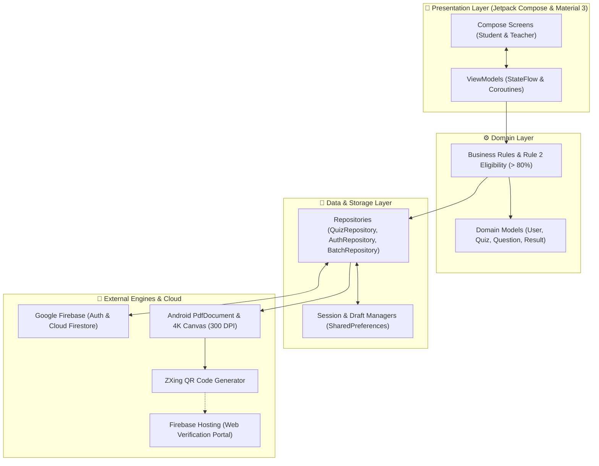

<div align="center">

# 🎓 QuizMaster

### *Modern Android Quiz & Assessment System with Verifiable 4K Digital Certificates*

[](https://developer.android.com)
[-brightgreen.svg?style=for-the-badge)](https://developer.android.com/about/versions/15)
[](https://kotlinlang.org)
[](https://developer.android.com/jetpack/compose)
[](https://firebase.google.com)
[-10B981.svg?style=for-the-badge&logo=checkmarx&logoColor=white)](#-automated-testing--qa)
[](https://github.com/Deb-Kumar/QuizMaster/releases)
[](#-building--compilation)
[](LICENSE)

---

[🌐 **Live Certificate Verification Portal**](https://quizmaster-dd2f8.web.app/verify/QM-JS92-20261125-003) • [✨ **Features**](#-features) • [🏛️ **Architecture**](#️-system-architecture) • [📜 **Certificate Engine**](#-verifiable-4k-certificate-engine) • [🔒 **Security Audit**](#-security--hardening) • [🚀 **Quickstart**](#-quickstart--installation)

</div>

---

## 📖 Overview

**QuizMaster** is an open-source, full-stack educational assessment platform tailored for schools, universities, and technical bootcamps. It bridges the gap between active mobile assessments on Android and authenticated public credential verification on the Web.

Built with **Jetpack Compose**, **Material 3**, and **Google Firebase**, QuizMaster supports student-teacher roles, dynamic batch enrollment, AI-assisted quiz authoring, countdown-timed exams, and automated issuance of cryptographic, **verifiable 4K Ultra-HD certificates of achievement**.

---

## 🌐 Live Web Verification Portal

Every issued certificate features a dynamic machine-readable **ZXing QR code**. When scanned by employers, admissions committees, or students, it loads the official QuizMaster verification portal deployed globally on **Firebase Hosting**:

👉 **Live Verification Portal:** [https://quizmaster-dd2f8.web.app/verify/](https://quizmaster-dd2f8.web.app/verify/)

* **Dual-Column Credential Showcase**: High-fidelity digital diploma view paired with a blockchain-grade cryptographic audit panel.
* **Instant Verification Actions**: Recipient validation, official academic seals, single-click **Print / Save as PDF**, and direct **Share Verification Link**.
* **Global 24/7 Availability**: Zero-latency worldwide edge hosting on Google Cloud with automated HTTPS certificates.

---

## ✨ Features

### 👨‍🎓 Student Experience
* **Adaptive Quiz Discovery**: Browse assessments by category (*Programming, Web Development, Mathematics*), difficulty level (*Easy, Medium, Hard*), or instructor-assigned batches.
* **Active Session Recovery**: Automatic background draft persistence saves remaining time and answer state, allowing students to seamlessly resume if interrupted.
* **Interactive Assessment Interface**: Clean multi-step question flows with immediate hint reveals, explanation cards, and real-time timer counters.
* **Official Certificate Issuance**:
  * Automatically issued upon meeting strict Rule 2 eligibility ($\text{Score} > 80.0\%$).
  * 300 DPI A4 landscape PDF download and in-app 4K bitmap preview.
  * Native Android share sheet integration.
* **Performance Analytics & History**: Detailed tracking of historical scores, completion rates, and pass/fail statistics.
* **Podium Leaderboards**: View real-time rank rankings across batches and globally.

### 👩‍🏫 Teacher & Instructor Suite
* **Interactive Quiz Studio**: Author comprehensive assessments with rich prompts, multiple options, correct answer tagging, and timer modes.
* **AI Quiz Generation**: Natural-language prompt parsing into structured JSON quizzes with automatic markdown striping and fallback repair.
* **Classroom & Batch Management**: Create cohort batches, generate unique invite codes, and review student membership requests with approval workflows.
* **Multi-Tenant Data Isolation**: Strict architectural boundaries ensure teachers only access questions, quizzes, and rosters belonging to their own classes.
* **Real-time Notifications**: Instant alerts when students submit tests or request batch access.

---

## 🏛️ System Architecture

QuizMaster adheres to **Clean Architecture** principles and **Unidirectional Data Flow (UDF)**:



---

## 📜 Verifiable 4K Certificate Engine

### 1. Mathematical Eligibility (Strict Rule 2)
Certificates are generated and issued **strictly when $\text{score} > 80.0\%$**:
$$\text{Eligible} \iff 80.0 < \text{Score} \le 100.0 \quad (\text{finite}, \ \text{non-NaN})$$
* A score of **80.0%** is **ineligible** (requires a retake).
* A score of **80.01%**, **92.0%**, or **98.0%** is **eligible**.

### 2. High-Precision Graphics & Layout
* **Resolution**: Rendered on a $4096 \times 2896$ px design canvas scaled to standard international **A4 Landscape (842 × 595 pt at 300 DPI)**.
* **Authenticity Assets**: Integrates official QuizMaster academic seals, Top Performer medals, and authorized examination director signatures.
* **Machine-Readable QR Code**: 192 × 192 px high-contrast ZXing matrix embedding the absolute verification URL.

---

## 🔒 Security & Hardening

The codebase was audited and hardened against OWASP Mobile Application Security guidelines:

* **Scoped FileProvider (`file_paths.xml`)**: Scoped file-sharing permissions strictly to `QuizMaster Certificates` and application cache, preventing full-sandbox file traversal attacks.
* **Data Extraction Prevention**: Disabled unauthorized OS-level ADB backups via `android:allowBackup="false"` in `AndroidManifest.xml`.
* **In-Memory Credential Hashing**: Offline fallback authentication hashes user passwords using `SHA-256`, preventing plaintext password leakage in heap dumps.
* **Input Sanitization**: File exports sanitize user-supplied names using strict alphanumeric regex with safe fallbacks, preventing directory traversal (`../../`).
* **Boundary Validation**: Mathematical validations reject negative values, numbers exceeding 100%, and non-finite values (`Double.NaN`, `Infinity`).

---

## 🧪 Automated Testing & QA

QuizMaster contains **63 automated unit and security tests** with a **100% pass rate**:

```powershell
# Execute the full unit & security test suite
.\gradlew.bat testDebugUnitTest
```

```text
> Task :app:testDebugUnitTest
BUILD SUCCESSFUL in 2s
63 tests completed, 0 failed, 0 skipped
```

### Verified Test Suites:
| Test Class | Focus Area | Status |
| :--- | :--- | :---: |
| [`CertificateSecurityAndEligibilityTest`](app/src/test/java/com/example/onlinequizapp/domain/CertificateSecurityAndEligibilityTest.kt) | Validates strict Rule 2 boundary thresholds, negative inputs, $>100\%$ rejections, `NaN`/`Infinity` safety, filename traversal, and SHA-256 hash security | **PASSED** |
| [`CertificateGeneratorTest`](app/src/test/java/com/example/onlinequizapp/domain/CertificateGeneratorTest.kt) | Verifies URL construction and basic score eligibility rules | **PASSED** |
| [`AuthAndTeacherTest`](app/src/test/java/com/example/onlinequizapp/domain/AuthAndTeacherTest.kt) | Tests authentication, session caching, role switches, and student profile updates | **PASSED** |
| [`BatchManagementTest`](app/src/test/java/com/example/onlinequizapp/domain/BatchManagementTest.kt) | Tests cohort batch creation, join requests, approval lifecycles, and memberships | **PASSED** |
| [`MultiTeacherDataIsolationTest`](app/src/test/java/com/example/onlinequizapp/domain/MultiTeacherDataIsolationTest.kt) | Verifies multi-tenant isolation so teachers cannot view or edit unauthorized quizzes | **PASSED** |
| [`QuizCreationAndPublishingTest`](app/src/test/java/com/example/onlinequizapp/domain/QuizCreationAndPublishingTest.kt) | Tests AI question generation, markdown sanitization, and publishing workflows | **PASSED** |

---

## 🚀 Quickstart & Installation

### Prerequisites
* **Android Studio**: Ladybug (2024.2+) or newer
* **JDK**: Version 17 or higher
* **Android SDK**: API 35 (Compile), API 23+ (Minimum)
* **Node.js**: v18+ *(optional, for Firebase Hosting web deployments)*

### 1. Clone the Repository
```bash
git clone https://github.com/Deb-Kumar/QuizMaster.git
cd QuizMaster
```

### 2. Configure Firebase
1. Create a project in the [Firebase Console](https://console.firebase.google.com/).
2. Enable **Firebase Authentication** (Email/Password & Google Sign-In) and **Cloud Firestore**.
3. Download `google-services.json` and place it in the `app/` directory.

### 3. Build & Run Android App
```powershell
# Build Debug APK
.\gradlew.bat assembleDebug

# Build Release APK
.\gradlew.bat assembleRelease
```
* Debug APK: `app/build/outputs/apk/debug/app-debug.apk`
* Release APK: `app/build/outputs/apk/release/app-release-unsigned.apk`

### 4. Deploy Web Verification Portal
```powershell
# Authenticate Firebase CLI
npx firebase-tools login

# Deploy the verification single-page app
npx firebase-tools deploy --only hosting
```

---

## 🛠️ Technology Stack Breakdown

* **Language**: [Kotlin](https://kotlinlang.org/) (2.x)
* **UI**: [Jetpack Compose](https://developer.android.com/jetpack/compose) with Material 3 Design
* **Concurrency**: Kotlin Coroutines & Asynchronous StateFlow
* **Backend Services**: [Firebase Authentication](https://firebase.google.com/docs/auth) & [Cloud Firestore](https://firebase.google.com/docs/firestore)
* **QR Engine**: [ZXing Core 3.5.3](https://github.com/zxing/zxing)
* **Image Loading**: [Coil Compose](https://coil-kt.github.io/coil/compose/)
* **Hosting**: [Firebase Hosting](https://firebase.google.com/docs/hosting)

---

## 🤝 Contributing

Contributions, issues, and feature requests are welcome!
1. Fork the Project.
2. Create your Feature Branch (`git checkout -b feature/AmazingFeature`).
3. Commit your Changes (`git commit -m 'Add some AmazingFeature'`).
4. Push to the Branch (`git push origin feature/AmazingFeature`).
5. Open a Pull Request.

---

## 📄 License

Distributed under the **MIT License**. See [`LICENSE`](LICENSE) for more information.

<div align="center">
  <br />
  <a href="https://github.com/Deb-Kumar">
    
  </a>
  &nbsp;
  <a href="https://instagram.com/alexx__285">
    
  </a>
  &nbsp;
  <a href="mailto:debkumarpayra32@gmail.com">
    
  </a>
  <br /><br />
  <sub>Engineered with precision for modern education. Maintained by <a href="https://github.com/Deb-Kumar"><b>Deb Kumar</b></a>.</sub>
</div>
